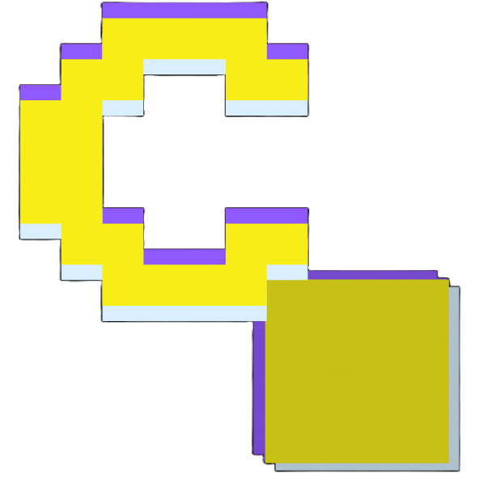

<div align="center">
  

  # BitChess

  **A retro-inspired, customizable 3D chess game that runs directly in your browser.**

  Play against a built-in bot or challenge someone on the same device. Customize the pieces, board, lighting, and atmosphere — no installation or build step required.

  
  
  
  
</div>

---

## ✨ About the project

BitChess is a lightweight, browser-based chess game built around a real-time 3D board and a deliberately pixel-inspired visual style. It combines standard chess rules with a customizable presentation: switch piece shapes and materials, create color palettes, change the background, and tune visual effects to make the board your own.

The game can be played solo against a built-in chess bot or locally with two players sharing one device. It is a static front-end project: the game does not require an application server, database, account, or build pipeline.

## 🎮 Features

### Chess gameplay

- **Play against the bot** with 21 selectable difficulty levels and an optional adaptive difficulty setting.
- **Local two-player mode** for games on the same device.
- **Choose your side** as White, Black, or random when playing against the bot.
- **Undo moves**, start a new game, and resume an unfinished game saved in your browser.
- **Move hints** and optional visual indicators for legal moves and the last move.
- **Promotion choices** for queen, rook, bishop, or knight.
- **Optional bot handicaps** for a more relaxed game.
- **PGN copy** to copy the current game's move record to the clipboard.

Move legality and core chess rules are handled by `chess.js`. The bot's search runs in a Web Worker so its calculations are less likely to block the interface.

### 3D visuals and customization

- A real-time **Three.js 3D chessboard** with animated moves and effects.
- Multiple piece shapes and material styles, including matte, metallic, glass-like, wood-like, neon, and more.
- Preset colors for pieces, board, and background, plus custom color selection.
- Save up to **10 custom palettes per category**.
- Optional shadows, piece outlines, move effects, automatic camera rotation, and a CRT-style filter.
- Camera controls for rotating and zooming the board.
- Adjustable rendering resolution and animation speed to help balance quality and performance.
- A Zen mode that hides the status display.
- Responsive pointer controls suitable for mouse, pen, and touch input on supported devices.

## 🕹️ How to play

1. Open BitChess and select **Play**.
2. Open the **Bot** settings to choose between the bot and two-player mode. When playing against the bot, choose a difficulty and side.
3. Select a piece, then select a highlighted destination square. You can also enable drag-and-drop in the view settings.
4. Use the bottom toolbar to undo a move, configure the opponent, adjust the camera, customize the skin, or open more options.

### Controls

| Action | Control |
| --- | --- |
| Select a piece or make a move | Click/tap a square, then click/tap a legal destination |
| Rotate the camera | Drag on the board |
| Zoom the camera | Use the mouse wheel or trackpad scroll |
| Move a piece by dragging | Turn on **Drag & Drop** in the view settings |
| Undo | Select **Undo** in the bottom toolbar |
| Change opponent or difficulty | Open **Bot** |
| Change the camera | Open **View** |
| Customize pieces, board, and background | Open **Skin** |
| Access hints, PGN, effects, and other settings | Open **More / Options** |

> **Tip:** The interface labels are currently in French. The feature descriptions in this README are in English, but in-game buttons may display labels such as *JOUER*, *VUE*, *SKIN*, and *PLUS*.

## 🚀 Getting started

### Requirements

- A modern browser with **WebGL** support.
- An internet connection when loading the page, because the game currently loads Three.js, chess.js, and its display font from external CDNs.
- Python 3 or a local development server such as the **Live Server** extension for VS Code.

### Run locally

1. Download or clone this repository.
2. Open a terminal in the project root — the directory containing `index.html`.
3. Start a local HTTP server:

   ```bash
   python -m http.server 8000
   ```

   On some Windows installations, use:

   ```powershell
   py -m http.server 8000
   ```

4. Open [http://localhost:8000](http://localhost:8000) in your browser.

A local server is recommended instead of opening `index.html` directly, because browser security rules can affect worker and resource loading from `file://` pages.

### Build and deployment

There is **no build step**. The repository is a static site, so a deployment service can publish the project root directly. For a static hosting provider, use the repository root as the site directory and leave the build command empty.

## 🧰 Technology stack

| Technology | Purpose |
| --- | --- |
| **HTML5** | Page structure and canvas container |
| **CSS3** | Responsive layout, pixel-art-inspired styling, panels, and transitions |
| **Vanilla JavaScript** | Game interface, interaction, rendering setup, settings, and persistence |
| **Three.js r128** | 3D scene, board and piece rendering, camera, lighting, and animation |
| **chess.js 0.10.3** | Legal moves, chess rules, game state, and PGN generation |
| **Web Workers** | Run the bot's search away from the main UI thread |
| **Google Fonts** | Press Start 2P display typeface |
| **localStorage** | Store visual preferences and the in-progress game in the browser |

The JavaScript libraries and font are loaded from CDNs in `index.html` and `script.js`. There is no `package.json` or dependency installation step in the current project.

## 📁 Project structure

```text
BitChess/
├── assets/
│   ├── icon.png          # Main project icon
│   ├── icon-32.png       # Browser favicon
│   └── icon-192.png      # App / home-screen icon
├── index.html            # HTML entry point and CDN dependencies
├── script.js             # Chess logic, bot, 3D scene, UI, and settings
├── style.css             # Layout, colors, and visual styling
└── README.md             # Project documentation
```

## ⚙️ Settings overview

BitChess groups its options into a few panels:

- **Bot:** game mode, bot level, adaptive difficulty, and player color.
- **View:** camera reset, drag-and-drop movement, and animation speed.
- **Skin:** piece shape and material, piece and board colors, background presets, gradients, and saved palettes.
- **Options — Game:** legal-move hints, last-move highlights, promotion selection, board rotation in local mode, sound and volume, and bot handicaps.
- **Options — Display:** piece outlines, effects, shadows, automatic rotation, CRT filter, Zen mode, contrast, and render resolution.
- **Options — Tools:** move hint, copy PGN, start a new game, randomize the skin, and reset saved settings.

Most preferences are saved automatically in the browser. Clearing the site's local storage removes those preferences and any saved in-progress game.

## 🔒 Privacy and browser storage

BitChess has no app backend and does not need an account. The current game and customization preferences are stored locally in your browser using `localStorage`; the game state is not sent to a BitChess server by the application code.

The page does request third-party resources for Three.js, chess.js, and the Press Start 2P font. The PGN copy feature uses the browser clipboard API, which may require the page to be served from `localhost` or HTTPS and for clipboard access to be permitted.

## 🛠️ Development notes

- **Entry point:** `index.html`
- **Main application logic:** `script.js`
- **Styles:** `style.css`
- **Assets:** `assets/`
- No compile, bundling, or package installation command is required.
- To change the game's look, start with the CSS variables near the top of `style.css` and the skin presets/settings in `script.js`.
- To change the external library versions or font, update the corresponding CDN URLs in `index.html` and the bot worker's `importScripts()` URL in `script.js` where applicable.

## 📄 License

This project is under MIT License.
---

<div align="center">
  <sub>BitChess — classic chess rules, reimagined in a customizable 3D pixel-style board.</sub>
</div>
